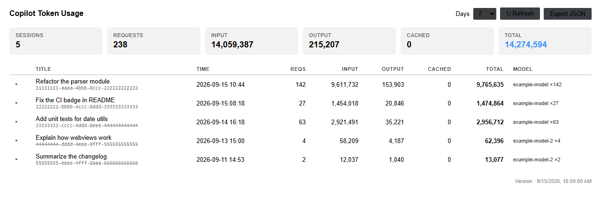
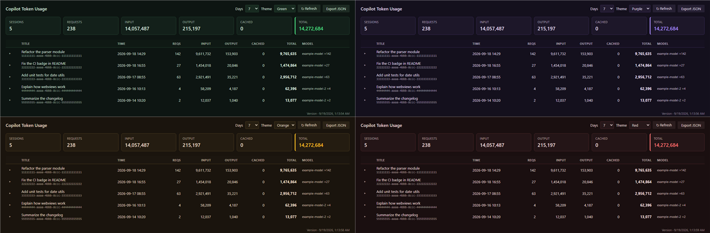

<p align="center">
  
</p>

> [Chinese (Simplified) README](README.zh-CN.md)

[](https://github.com/yuyuanjingxuan/copilot-tokens/actions/workflows/ci.yml)
[](https://coveralls.io/github/yuyuanjingxuan/copilot-tokens)
[](https://marketplace.visualstudio.com/items?itemName=yuyuanjingxuan.copilot-tokens)
[](https://code.visualstudio.com/)
[](https://www.python.org/)
[]()
[](LICENSE)

Token usage tracker for VS Code Copilot Chat (Windows / macOS / Linux).

Parses the built-in Copilot Chat debug logs (`main.jsonl`) and aggregates
input / output tokens, model, and latency per LLM request and per session.
Available as a **native VS Code extension** (themed webview panel) and a
**zero-install Python CLI** — both share identical parsing.

## Why this exists

- Since VS Code 1.13x, empty-window chat sessions write their debug logs to
  `globalStorage/github.copilot-chat/debug-logs/`, while several third-party
  tracker extensions only scan the older `workspaceStorage` path — so they
  show "no sessions found"
- BYOK (bring-your-own-key) users don't see usage on the GitHub billing page;
  local log analysis is the only option
- This tool parses `llm_request` events directly from the logs and relies on
  no VS Code internal APIs

## Prerequisites

Enable debug log file writing in VS Code settings:

```json
"github.copilot.chat.agentDebugLog.fileLogging.enabled": true
```

> With this setting on, full request logs for every session are written to
> local disk. Turn it off if you don't want logs persisted (this tool will
> then have no data to read).

## VS Code extension

A native VS Code extension wraps the parser in a themed webview panel —
summary cards, a per-session table, and expandable per-request detail. It
follows your light/dark theme, supports English / Chinese (auto-detected),
and offers five full-page color themes (default / green / purple / orange /
red, persisted in settings).

- **Activity bar icon** — click the icon on the left to open the dashboard
  in the sidebar; `Copilot Tokens: Show Usage` opens the full-width tab
- **Status bar** — total tokens for the selected window on the right side
  of the status bar; click to open the panel
- **Auto-refresh** — re-scans the logs every 60 s by default
  (`copilotTokens.autoRefresh`, `0` disables)
- **Disable / Enable** — `Copilot Tokens: Disable` stops all background
  activity (auto-refresh, status bar, panel); `Enable` restores it
- **Deleted sessions** — sessions removed from the VS Code chat list are
  still counted (the tokens were consumed) but grouped at the bottom of the
  table with a "Deleted" badge
- **Daily usage chart** — per-day bar / line / area chart of token usage
  over the selected window, with a metric switch (total tokens, input +
  output, requests), hover tooltips, and an optional log-scale y-axis

> **How the selected window is counted.** The window (7 / 14 / 30 / 60 /
> 90 days, or "All") is applied to **request timestamps**, not to when a
> session was last active. Only requests whose timestamp falls inside the
> window are counted and drawn — a session that started weeks ago but had a
> request today contributes only today's request, and the chart never shows
> data outside the selected range. Sessions with no in-window requests are
> omitted. (For performance, log files whose last write predates the window
> are skipped entirely; a request can only exist in a file that was written
> around the same time, so this does not change the result.)





```
extension/
├── src/
│   ├── extension.ts   # command + webview panel
│   ├── parser.ts      # log discovery & parsing (same logic as the CLI)
│   ├── i18n.ts        # en / zh-CN strings
│   └── webview.ts     # panel HTML/CSS/JS
├── package.json
└── tsconfig.json
```

### Install (Marketplace)

1. Open the Extensions view (<kbd>Ctrl</kbd>+<kbd>Shift</kbd>+<kbd>X</kbd>)
2. Search for **Copilot Tokens** and click **Install**
   (or go straight to the
   [marketplace listing](https://marketplace.visualstudio.com/items?itemName=yuyuanjingxuan.copilot-tokens))
3. Click the **Copilot Tokens** icon on the activity bar (or run the
   command **Copilot Tokens: Show Usage**)

Updates are delivered automatically through the Marketplace.

### Install (.vsix, manual)

Prefer to install a specific version by hand?

1. Download `copilot-tokens-x.y.z.vsix` from the
   [latest release](https://github.com/yuyuanjingxuan/copilot-tokens/releases)
2. <kbd>Ctrl</kbd>+<kbd>Shift</kbd>+<kbd>P</kbd> → **Extensions: Install from VSIX…** → pick the file
3. Run the command **Copilot Tokens: Show Usage**

### Develop from source (F5)

Want the very latest version before it hits the Marketplace?

1. Clone this repo and open the `extension/` folder in VS Code
2. Run `npm install`
3. Press <kbd>F5</kbd> (Run Extension) — a second VS Code window opens with
   the dev build
4. In that window, run the command **Copilot Tokens: Show Usage**

### Commands

| Command | Action |
|---|---|
| `Copilot Tokens: Show Usage` | Open the usage panel (full-width tab). This **only opens the panel to view data** — it does **not** change the enabled/disabled state. It works even while the extension is disabled (see below). |
| `Copilot Tokens: Refresh` | Re-scan the logs and update the panel |
| `Copilot Tokens: Export JSON` | Save the current report as a JSON file |
| `Copilot Tokens: Disable` | Stop all background activity: the auto-refresh timer, the status bar item, and the panel. The extension stays loaded but does no background work. |
| `Copilot Tokens: Enable` | Restore everything that `Disable` stopped (auto-refresh, status bar, panel). |

**How the commands relate — read this to avoid confusion:**

- **`Show Usage` vs `Enable`.** `Show Usage` only *opens the panel to look at data*; it does **not** turn the extension back on. `Enable` is the only command that *restores background work* (auto-refresh + status bar). If the extension is disabled and you run `Show Usage`, the panel opens so you can view data, but the status bar stays hidden and auto-refresh stays off until you run `Enable`.
- **`Disable` vs fully unloading.** `Disable` only stops the extension's *background work*; the extension itself stays loaded in the extension host. To fully unload it (free its memory), disable it from the **Extensions view** instead.
- **While disabled.** The sidebar view (activity bar icon) and `Show Usage` still open so you can view data, but nothing auto-refreshes and the status bar is hidden until you run `Enable`.

### Settings

| Setting | Default | Description |
|---|---|---|
| `copilotTokens.days` | `7` | Default day window when opening the panel |
| `copilotTokens.autoRefresh` | `60` | Auto-refresh interval in seconds; `0` disables |
| `copilotTokens.language` | `auto` | UI language: `auto` / `en` / `zh-CN` |
| `copilotTokens.theme` | `default` | Panel color theme: `default` / `green` / `purple` / `orange` / `red` |
| `copilotTokens.chartType` | `bar` | Daily chart type: `bar` / `line` / `area` |
| `copilotTokens.chartMetric` | `total` | Daily chart metric: `total` / `stacked` / `requests` |
| `copilotTokens.chartLogScale` | `false` | Logarithmic y-axis for the daily chart |

## Python CLI (zero-install)

Prefer the terminal? A single-file, pure-stdlib Python script (no
dependencies, Python 3.9+) does the same job — including grouping
sessions removed from the VS Code chat list at the bottom with a
`[Deleted]` marker (totals still include them).

### Install

Nothing to install — just run it:

```bash
# Windows: double-click cli/copilot_tokens.bat, or run in a terminal
python cli/copilot_tokens.py

# Optional: make it available globally
# Windows
copy cli\copilot_tokens.py %USERPROFILE%\scripts\
# macOS / Linux
cp cli/copilot_tokens.py ~/.local/bin/ && chmod +x ~/.local/bin/copilot_tokens
```

### Usage

```
python cli/copilot_tokens.py             # sessions from the last 7 days
python cli/copilot_tokens.py --days 30   # last 30 days
python cli/copilot_tokens.py --all       # all sessions
python cli/copilot_tokens.py --top 5     # top 5 sessions by total tokens
python cli/copilot_tokens.py --session 6ec414c0   # per-request detail (prefix match)
python cli/copilot_tokens.py --json      # JSON output
python cli/copilot_tokens.py --json --out usage.json   # export UTF-8 JSON file
python cli/copilot_tokens.py --root /path/to/User      # non-standard VS Code "User" dir
```

### Sample output

```
Session    Time            Reqs       Input     Output    Cached     Total  Model / Title
──────────────────────────────────────────────────────────────────────────────────────────
6ec414c0 09-18 19:07     37      2.9M      60k        0      3.0M  qwen3.8-27b×37  Help me write a script…
a8ba8abd 09-18 18:34      1     9,360      157        0     9,517  qwen3.8-27b  Who are you
──────────────────────────────────────────────────────────────────────────────────────────
Total                      38      2.9M      60k        0      3.0M  2 sessions
```

Detail view (`--session <id>`):

```
Session a8ba8abd-…
  Versions: VS Code 1.138.0 / Copilot 0.66.0
  Time:     09-18 17:49 → 09-18 18:34
  Title:    Who are you

  #  Time             Dur        Input    Output   Cached  Model
──────────────────────────────────────────────────────────────
  1  09-18 18:13     5.6s     9,360     157        0  qwen3.8-27b
──────────────────────────────────────────────────────────────
                              9,360     157        0  Total
```

## Data sources

Both the extension and the CLI auto-discover logs in both layouts (new and
legacy):

| Layout | Path |
|---|---|
| New (VS Code 1.13x+, includes empty-window sessions) | `%APPDATA%/Code/User/globalStorage/github.copilot-chat/debug-logs/<sid>/main.jsonl` (Windows)<br>`~/Library/Application Support/Code/User/globalStorage/…` (macOS)<br>`~/.config/Code/User/globalStorage/…` (Linux) |
| Legacy (per workspace) | `%APPDATA%/Code/User/workspaceStorage/<hash>/GitHub.copilot-chat/debug-logs/<sid>/main.jsonl` |

Event types parsed (`main.jsonl` is JSONL, one event per line):

| Event | Used for |
|---|---|
| `llm_request` | `attrs.inputTokens` / `attrs.outputTokens` / `attrs.model` / `attrs.ttft`; top-level `ts` (epoch ms) / `dur` (ms) |
| `user_message` | first message becomes the session title |
| `session_start` | VS Code / Copilot version info |

### Known limitations

- **Cached tokens are not recorded**: VS Code currently does not write cache
  read/write tokens to the log (see
  [microsoft/vscode#329657](https://github.com/microsoft/vscode/issues/329657)).
  The parser reserves a `cachedTokens` field; it will light up automatically
  once the format supports it
- Input tokens are the **full context of each request** (system prompt,
  history, tool results), so multi-turn sessions show a large "input" total —
  this is normal context accumulation, not double counting
- The log format is an internal VS Code implementation with no stability
  guarantee. If data goes missing after a VS Code upgrade, please open an
  issue with one `llm_request` event from your `main.jsonl` (**redacted**)

## Privacy

- The tool is **read-only** over local log files. It never phones home or
  uploads anything
- Session titles come from your first user message — review exported JSON
  for sensitive content before sharing
- Never commit raw `main.jsonl` logs to any repository

## License

[MIT](LICENSE)
