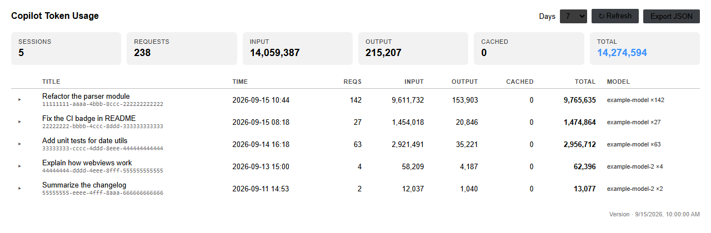

# copilot-tokens

Token usage tracker for VS Code Copilot Chat. A zero-dependency Python CLI
that reads the local Copilot Chat debug logs and totals up input / output
tokens, model, and latency per request and per session.

Pure standard library. No dependencies. Python 3.9+.

## Why this exists

- Since VS Code 1.13x, empty-window chat sessions write their debug logs to
  `globalStorage/github.copilot-chat/debug-logs/`. Several third-party
  tracker extensions only scan the older `workspaceStorage` path, so they
  end up showing "no sessions found".
- BYOK (bring-your-own-key) users don't see usage on the GitHub billing
  page, so reading the local logs is the only option.
- This tool reads `llm_request` events straight from the logs and does not
  rely on any VS Code internal API.

## Prerequisite

Enable debug log file writing in VS Code settings:

```json
"github.copilot.chat.agentDebugLog.fileLogging.enabled": true
```

> With this on, the full request logs for every session are written to local
> disk. Turn it off if you don't want logs persisted (the tool will then
> have nothing to read).

## Install

```bash
pip install copilot-tokens
```

Or run it without installing:

```bash
pipx run copilot-tokens
```

## Usage

```bash
copilot-tokens                          # sessions from the last 7 days
copilot-tokens --days 30                # last 30 days
copilot-tokens --all                    # all sessions
copilot-tokens --top 5                  # top 5 sessions by total tokens
copilot-tokens --session 6ec414c0       # per-request detail (prefix match)
copilot-tokens --json                   # JSON output
copilot-tokens --json --out usage.json  # export UTF-8 JSON file
copilot-tokens --root /path/to/User     # non-standard VS Code "User" dir
copilot-tokens --version                # print version
```

The JSON output includes a `models` object per session, keyed by model name,
with `count`, `input_tokens`, `output_tokens`, `cached_tokens`, and
`total_tokens` for each model used in that session.

## Sample output

```
Session    Time            Reqs       Input     Output    Cached     Total  Model / Title
──────────────────────────────────────────────────────────────────────────────────────────
6ec414c0 09-18 19:07     37      2.9M      60k        0      3.0M  qwen3.8-27b×37  Help me write a script…
a8ba8abd 09-18 18:34      1     9,360      157        0     9,517  qwen3.8-27b  Who are you
──────────────────────────────────────────────────────────────────────────────────────────
Total                      38      2.9M      60k        0      3.0M  2 sessions
```

Detail view (`--session <id>`):

```
Session a8ba8abd-…
  Versions: VS Code 1.138.0 / Copilot 0.66.0
  Time:     09-18 17:49 → 09-18 18:34
  Title:    Who are you

  #  Time             Dur        Input    Output   Cached  Model
──────────────────────────────────────────────────────────────
  1  09-18 18:13     5.6s     9,360     157        0  qwen3.8-27b
──────────────────────────────────────────────────────────────
                              9,360     157        0  Total
```

## Data sources

Both layouts are auto-discovered (new and legacy):

| Layout | Path |
|---|---|
| New (VS Code 1.13x+, includes empty-window sessions) | `%APPDATA%/Code/User/globalStorage/github.copilot-chat/debug-logs/<sid>/main.jsonl` (Windows)<br>`~/Library/Application Support/Code/User/globalStorage/…` (macOS)<br>`~/.config/Code/User/globalStorage/…` (Linux) |
| Legacy (per workspace) | `%APPDATA%/Code/User/workspaceStorage/<hash>/GitHub.copilot-chat/debug-logs/<sid>/main.jsonl` |

Event types parsed (`main.jsonl` is JSONL, one event per line):

| Event | Used for |
|---|---|
| `llm_request` | `attrs.inputTokens` / `attrs.outputTokens` / `attrs.model` / `attrs.ttft`; top-level `ts` (epoch ms) / `dur` (ms) |
| `user_message` | first message becomes the session title |
| `session_start` | VS Code / Copilot version info |

## Known limitations

- **Cached tokens are not recorded.** VS Code currently does not write cache
  read/write tokens to the log (see
  [microsoft/vscode#329657](https://github.com/microsoft/vscode/issues/329657)).
  The parser reserves a `cachedTokens` field; it will light up automatically
  once the format supports it.
- Input tokens are the **full context of each request** (system prompt,
  history, tool results), so multi-turn sessions show a large "input" total.
  This is normal context accumulation, not double counting.
- The log format is an internal VS Code implementation with no stability
  guarantee. If data goes missing after a VS Code upgrade, please open an
  issue with one `llm_request` event from your `main.jsonl` (**redacted**).

## Privacy

- The tool is **read-only** over local log files. It never phones home or
  uploads anything.
- Session titles come from your first user message. Review exported JSON
  for sensitive content before sharing.
- Never commit raw `main.jsonl` logs to any repository.

## VS Code extension

There is also a native VS Code extension with a themed webview panel,
status bar total, daily usage chart, and CSV / JSON export. Install it from
the [Marketplace](https://marketplace.visualstudio.com/items?itemName=yuyuanjingxuan.copilot-tokens).



## License

[MIT](https://github.com/yuyuanjingxuan/copilot-tokens/blob/main/LICENSE)
